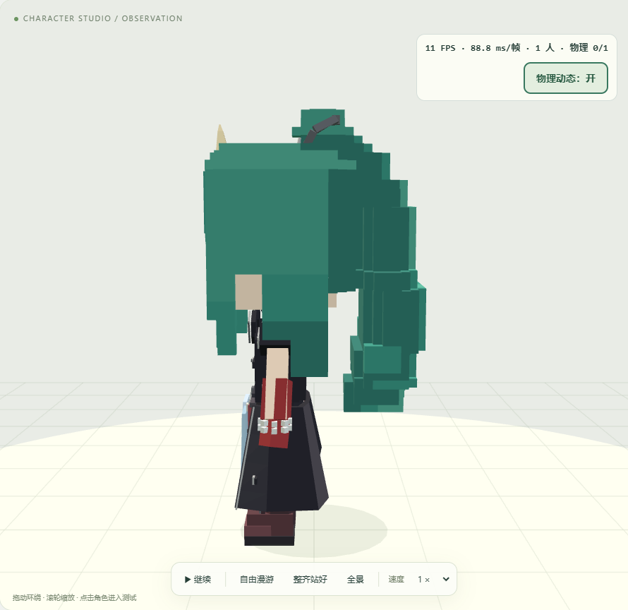
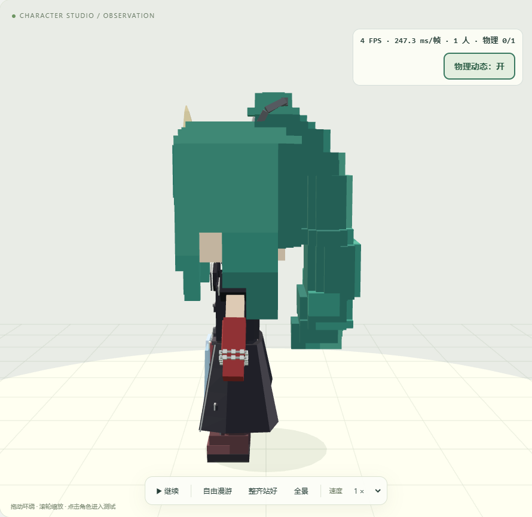

# 星熊：修好直臂后，旧护臂没有同步适配

[返回入口](README.md) · 对应角色：斩业星熊，`char_1044_hsgma2`

## 现象与观察条件

以下为同一角色留存的侧面截图。v3 已完成直方臂，但红色护臂中间仍有明显的纵向肤色条，腕饰也不连续。v4 的同一区域改为连续红色包覆。以红护臂从袖口下方到手腕的侧面为观察对象，避免把正常裸露上臂误判为漏洞。

| v3：修臂后 | v4：包覆修订后 |
| --- | --- |
|  |  |

截图中的 FPS 是当时 UI 读数，未控制运行环境，不能据此比较性能。

## 证据、影响与状态

R2 版本说明将 v3 直臂与 v4 包覆明确分开。真实 v3 源码留在 `playground/backups/glove-wrap-v4/character/model.mjs`；它已经创建直方臂，却仍用旧斜护臂、掌和离散珠环，再按顶点 y 偏移 x。v4 则通过 `wristMatrix/localBox` 共用手臂局部正交坐标，并显式生成前后左右四面腕环。见 [W3/W4 摘录](source-excerpts.md)。

这说明改中心线或截面后，配件原来的适配条件会失效。代码和侧图支持这是本地修复阶段的次生问题，不能全部归给云端原始生成。v4 已有修订记录，这两张既有侧图也支持对应缺口改善；本报告没有重新运行当前 v4。

现行导入规则已经要求同局部坐标、四面包覆及受影响动作验证。问题应表述为历史修复/验收未挡住缺陷，不能反推“现在完全没有这条规则”。v3/v4 的运行记录中 `errors: []` 也不能证明外观包覆正确。

## 人工复核与不能断言的部分

1. 确认实际加载的是 v3 或 v4 导出物，不能仅看仍名为 `revision-v2` 的目录。
2. 保持相近姿态和尺度，查看正、侧、背及必要斜视；红护臂、手、腕环分别查缺面、露肤、漂浮、断接。
3. 如需认证当前模型，加载实际交付 GLB 与网页入口，复测受影响弯肘和转腕；本目录的两张静态图只能支持对应侧面的变化。

不能从 v4 单一侧面断言全动作安全、全部四面已在本轮通过；也不能从两个 runtime 数值相同推断造假。未查完整历史时序，不能确定每次修复时执行者看到的规则文本。
