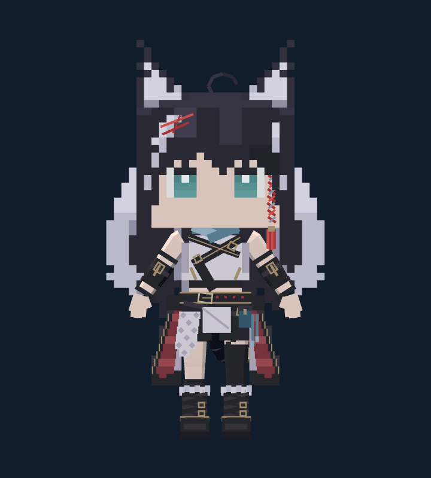
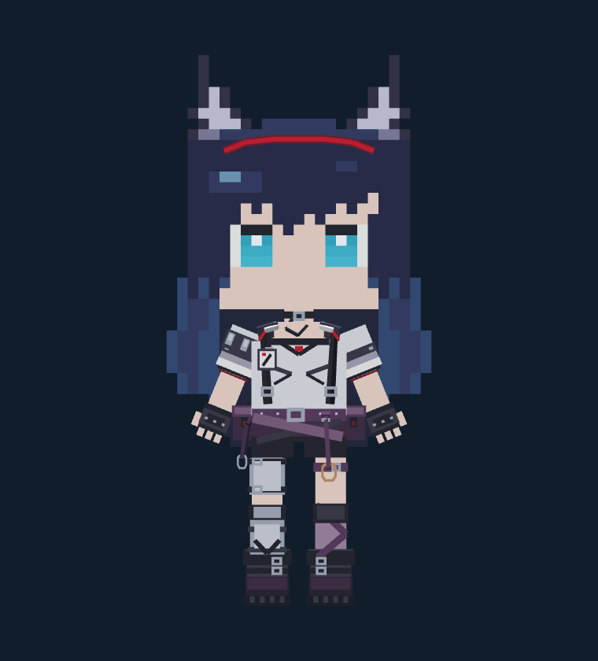
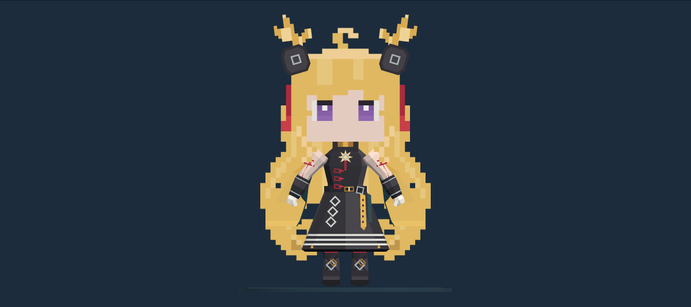

# SU-001 六例：原始问题不是同一种

[返回入口](README.md)

下面六张均为原交付留存正面图。图片适合观察轮廓，精确的截面、中心线和指块构造还需结合 [源码摘录](source-excerpts.md)。本轮读取了六份修订说明，但没有重跑修正版 GLB、动作或用户外观验收。手指构造是事实描述，不是严重度评分。

## 1 · 假日威龙陈 · char_1013_chen2

- **现象：**裸臂原本沿肩腕直线、恒宽，但截面为八角；袖子多段鼓收，小腿向下收细，手为掌、四指和拇指。
- **观察条件与证据：**静态正面先看袖子和小腿；裸臂被袖遮挡，不能仅凭截图判弯臂。源码 C1 的 `axis/at`、八点环、固定半径与袖半径数组分别支持以上区别。
- **影响：**“把所有弯臂拉直”会错过这个案例真正需要检查的截面、袖形和腿形。
- **当前状态：**修订记录 R1 记载四角截面、单块手、等宽腿和角色专属缩腿。已有修正版，未替用户批准外观。
- **人工复核：**在原件和修订件的正、侧、斜视中分开看皮肤与袖子，核对袖口开口与橙色标记是否保留。
- **不能断言：**原裸臂是曲线或肌肉臂；所有宽袖都应改贴身；本角色缩腿比例适用于其他角色；原手必然超过现行临界标尺。

## 2 · 斩业星熊 · char_1044_hsgma2

- **现象：**肩肘腕多点折线、半径变化与八角截面并存；手另建四指及拇指，腕饰为离散环状小块。
- **观察条件与证据：**静止正面可见裸臂转折；精确结构见 C2。图中裙装遮挡腿，不从此图推断腿截面。
- **影响：**只把八角改四角仍可能保留折线轴；修臂还可能使配件不再适配。
- **当前状态：**R2 记录 v2 截面修改、v3 共线直臂、v4 包覆修订。当前目录仍名为 `revision-v2`。[次生问题单列](case-wrap.md)。
- **人工复核：**先读修订记录，再看正侧背；区分左侧红护臂与另一侧裸手，检查腕带连续性。
- **不能断言：**所有缺陷都来自云端原版；目录中的旧 HTML 就是修正版入口；本轮已完成当前 v4 全动作复测。

## 3 · 烛煌 · char_1040_blaze2

- **现象：**八角扫掠沿多点路径制作，手臂宽深逐段变化；另建多个指块，腿也有收细。
- **观察条件与证据：**正面可看肩至护臂的转折及露腿轮廓；手指在此分辨率下不清楚，构造证据来自 C3，不能把不清楚的指缝当成图像已证实。
- **影响：**护带遮挡会降低单张截图的判别力；只修臂不代表腿同时符合标准。
- **当前状态：**R3 记录 v2 方截面/手修订及 v3 肩腕共线；不扩写为全部腿形已修复。
- **人工复核：**查局部斜侧面和手腕近景，分别记录臂、手、腿、护带；确认护带随新表面适配。
- **不能断言：**原手按现有四图一定超临界；未找到的出图 prompt 永久不存在；既有出图 `pass` 等于建模验收。

## 4 · 煌 · char_017_huang

- **现象：**原手臂就是整体旋转的直方盒；问题调查涉及另建的三指及拇指，不能归为弯曲肌肉臂。
- **观察条件与证据：**正面看裸臂直边；C4 的 `BoxGeometry` 与统一旋转矩阵证明局部几何仍直方，后续两行单独生成手指。
- **影响：**若以“六例统一修臂”处理，会重做本已符合直臂要求的部件。
- **当前状态：**R4 记载仅改双手、保留装饰，手臂及其他 39 个网格未改；这是历史修订记录，本文未重算网格差异。
- **人工复核：**先确认臂正常，再按四图比较手部；如为轻度或临界应保留，不因历史曾修手就要求今后同类全部修。
- **不能断言：**只要三根手指就是不合格；整个 A pose 的倾斜就是局部臂弯曲。

## 5 · 琳琅诗怀雅 · char_1033_swire2

- **现象：**臂沿多点路径逐段收细，掌、四指、拇指分建，小腿收细；宽袖属于单独的衣物结构。
- **观察条件与证据：**正面看袖口以下与露腿；袖内臂结构见 C5 的路径及半径数组。共享 `tube` 还用于服装及配件。
- **影响：**全局替换几何生成器可能误改头饰、衣物或其他本不需修的部件。
- **当前状态：**R5 记载直臂、块手、腕带包覆、方形等粗腿及飘袖修订。
- **人工复核：**分别看裸肢与宽袖；修订后核对袖花纹、开口、腕带及鞋口，不能只检查手臂数值。
- **不能断言：**蓬袖本身是肌肉问题；所有 tube 都应改成同一形状；原手的严重度可按指头数量决定。

## 6 · 司霆惊蛰 · char_1043_leizi2

- **现象：**肩肘腕折线、臂半径鼓收、八角环；手为手套体加独立拇指，**不是四根细指**。
- **观察条件与证据：**正面看上臂/护臂轮廓；C6 的三点路径、半径及手套/拇指构造补足遮挡信息。
- **影响：**套用其他五例的多指描述会错判此例；改臂后红色臂带还需重新贴表面。
- **当前状态：**R6 记录直臂、块手、包覆和红臂带重新贴合；未在本文作当前动作复测。
- **人工复核：**近看手套与拇指，在正侧背检查臂带及护臂是否露肤或漂浮。
- **不能断言：**有独立拇指即超过临界；长裙下被遮挡腿部已有充分视觉证据；缺失 prompt 可自行补造。

六例的来源和修订位置见 [追溯索引](sources.md)。本报告不重新为六双手定级：需实际目标版本、相近尺度的正面及斜侧证据，现有正面图与代码不足以完成这项审美分流。
