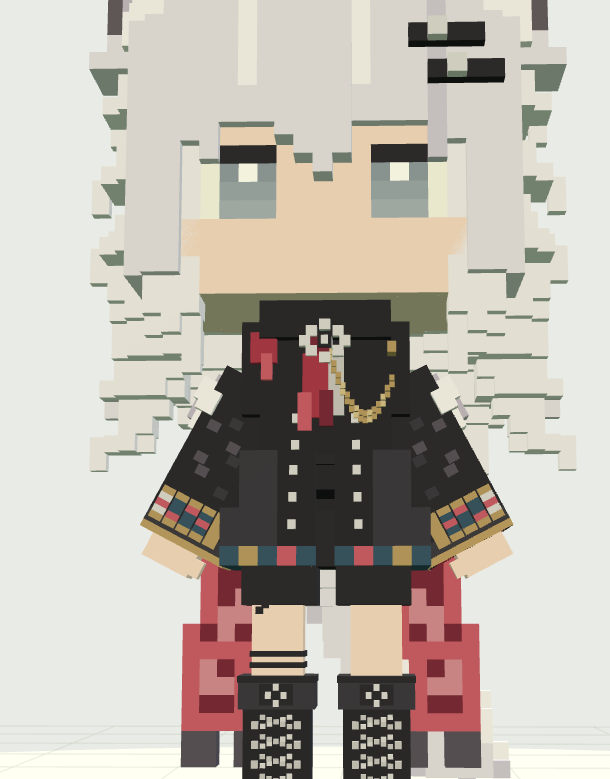
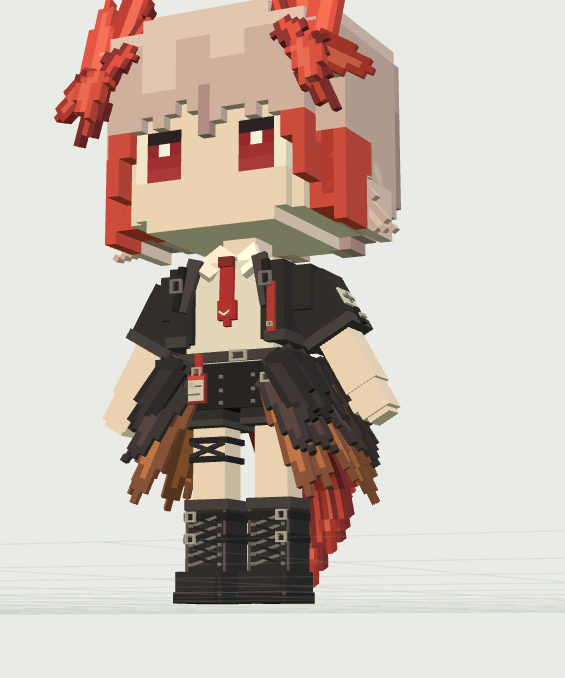
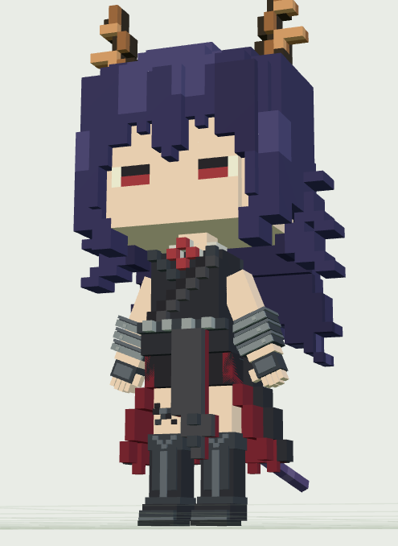
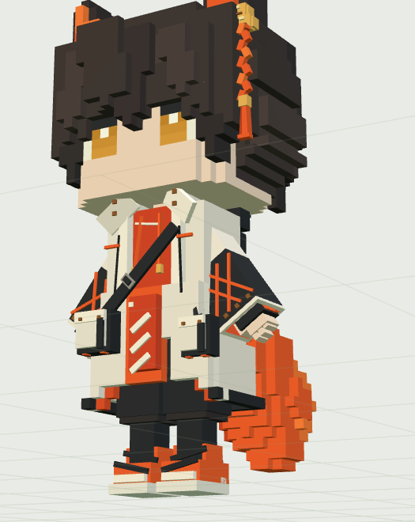

# 手部标尺：容忍程度优先于统一方手

[返回入口](README.md)

这是既有用户确认的四张原始标尺，不是本次新增的失败案例，也不是要求修复这四个模型。SU-002 已逐张查看并原样复制；不重新解释为指头数量、指缝宽度或百分比标准。

| 程度 | 手臂正常 | 手臂存在风格问题 |
| --- | --- | --- |
| 轻度，图 1/2 水平 | 保留手 | 修臂；轻度手仍保留，只做必要衔接和包覆调整 |
| 临界，图 3/4 水平 | 保留手，不为统一而修 | 修臂，并一起修临界手及腕部衔接 |
| 明显超过图 3/4 | 修手 | 臂和手都修 |

## 图 1、图 2：轻度，可接受

## 图 3、图 4：临界，臂正常则保留

**观察条件与人工复核：**将待检查模型调整到相近角色显示尺度，查看正面及斜侧面，先判臂是否有问题，再对照手。看不清则补视角；临界边缘优先保留。记录 `hand_severity`、`arm_issue`、保留/修复与依据，保留项可记 `accepted_unchanged`。

**影响与当前状态：**规则已存在于导入修复标准；SU-001 指出的缺口是独立生成与验收端的明确传递。此次优化发布状态待发布任务核对，尚无新生成结果证明效果。不得据此自动回滚已完成的历史修订。

**不能断言：**独立指头、小拇指凸起或指缝都代表失败；单张正面图能给所有手准确分级。手套缺面、穿出、漂浮、断开是独立缺陷，不能因手部轻度而忽略。来源：S5，见 [索引及规则摘录](source-excerpts.md)。
