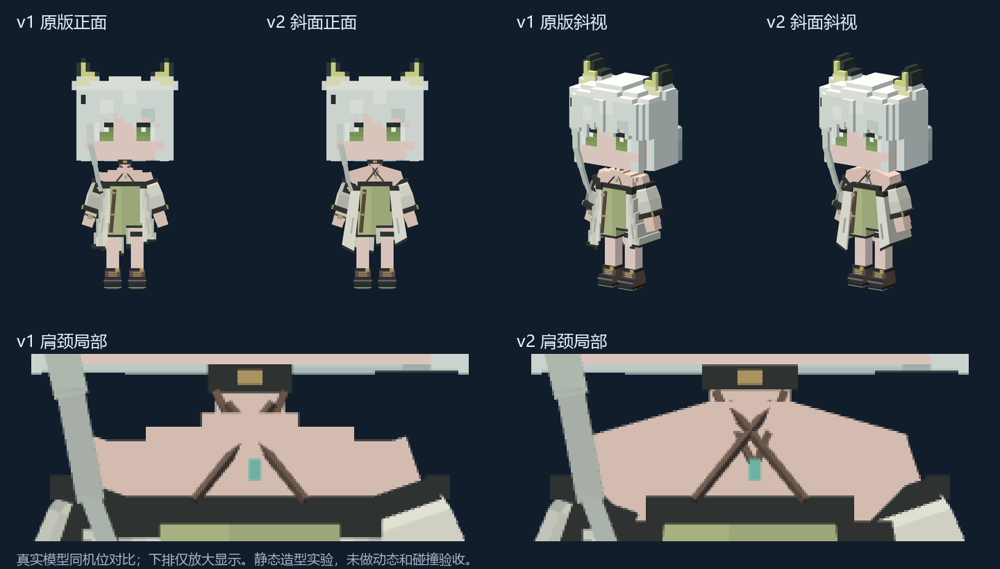
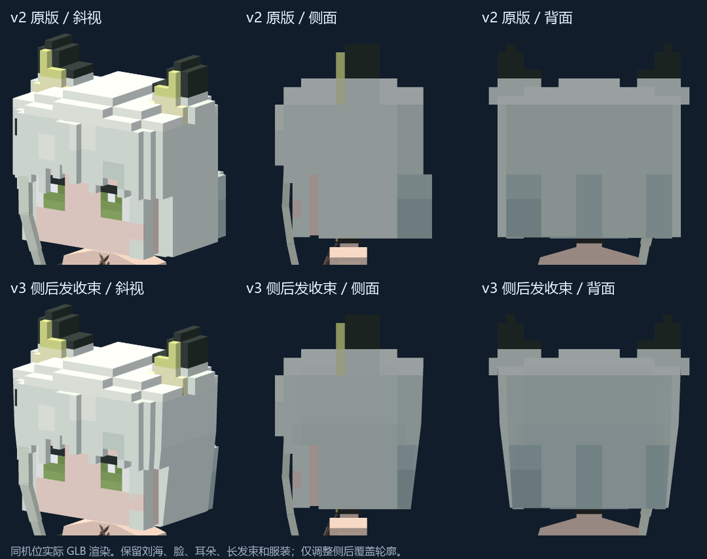
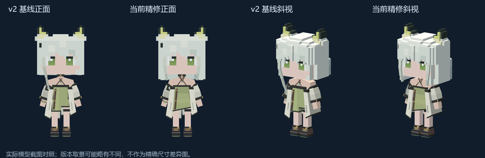
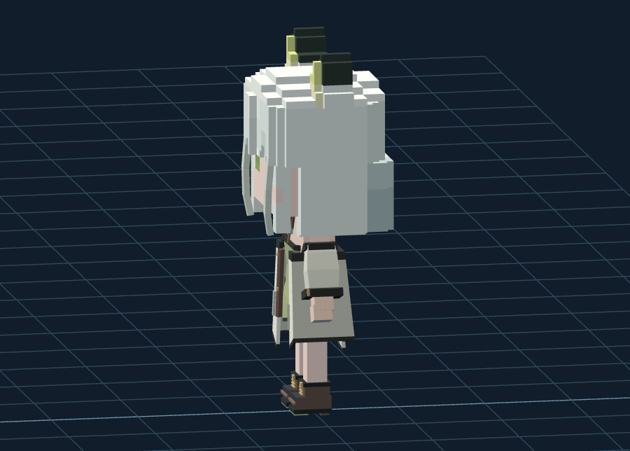
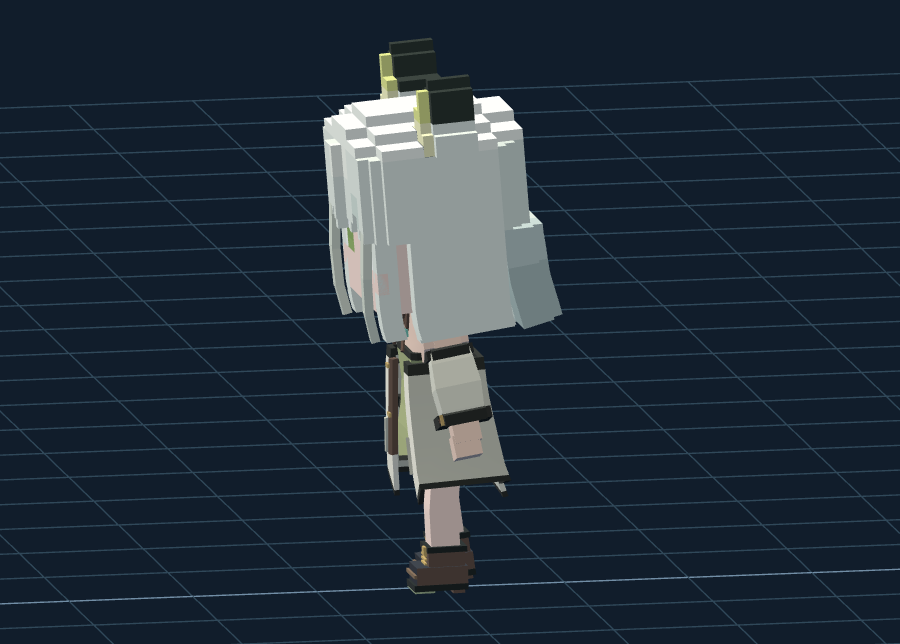

# 凯尔希：历史失败、局部修正和运行时边界

[返回入口](README.md)

版本路径：quick v1 → angled v2 → hair v3 → reference v4 → 回退 v2 → refined → 项链/强前进补强。以下根据历史复盘、留存图和既有专项报告整理；用户反馈以历史记录转述，未附私密会话。最终专项记录对应 GLB SHA-256：`1cf7d96fa106f944cddeeee60099ed2dbe02223b5482f9bfb560c832ee56044a`。

## K1 · 肩胸与袖口：技术可加载不代表结构自然

- **现象：**v1 的细颈、阶梯肩胸和外套观感被指出有问题；v2 以紧凑颈根、连续硬边斜面及厚裁片修正。
- **观察条件与证据：**图下排为肩颈局部，结合正面/斜视观察肩至袖口连续性。K0 历史复盘记录用户认可 v2 肩膀与外套。
- **影响：**把“体素”理解成任何地方都只能阶梯堆块，会妨碍露肩连接和衣物裁片表达。
- **当前状态：**v2 肩胸/外套被后续 refined 保留。袖内壁空间等问题在精修时另有调整记录，当前图不能单独证明袖内壁动态净空。
- **人工复核：**看前、侧、背的人体连接和衣物覆盖边界，再看实际袖内表面；不能只看外包围盒。
- **不能断言：**必须先做差的阶梯肩再改；所有部件都应曲面化；认可 v2 局部等于认可最终全部外观。

## K2 · 发长与发型：旧模型和“短发”标签都不够

- **现象：**v3 沿旧模型改折面后，历史反馈仍指其不匹配多角度参考；后续 v4 也被否决并回退。refined 按明确纠正把侧后发延到颈根附近、双侧面前鬓发近似等长。
- **观察条件与证据：**上图上排 v2、下排 v3，能观察侧后发轮廓变化；是否符合原设计的判断来自 K0 用户反馈记录。下节 refined 对照可看双侧鬓发关系改变。
- **影响：**继承错误发长再做表面精细化，仍然会偏离身份设计；静态加载通过不解决这一点。
- **当前状态：**v3/v4 发型重构未进入最终版本；refined 保留认可的块状表达并修长度。
- **人工复核：**分别列刘海、鬓发、侧发、后发的终点地标和左右关系，核对三视图，不仅写“短发”。
- **不能断言：**所有角色都要双鬓等长或颈根发长；所有局部斜面都失败；v4 目录中名为 comparison 的图就是 v4 成果。

**来源陷阱：**本轮实际查看发现 v4 目录的 `comparison.png` 仍标 v1/v2，与 angled v2 对照图 SHA-256 完全相同。因此本文只将它们视为旧对照，v4 被否决仅由历史复盘支持，不把旧图当作 v4 实物证据。详见 S8。

## K3 · 衣物类别：紧身裙不能按两条裤腿绑定

- **现象：**历史反馈指出绿色内搭被做得像长短不同的两条裤腿；refined 改为连续紧身裙与斜下摆。
- **观察条件与证据：**比较前两列的绿色内搭下缘和开口。K0 记录类别纠正，K1 源 README 说明连续裙体、无裆部开口、形变不分别跟随左右腿。图中取景不同，不用作精确尺寸测量。
- **影响：**类别读错会连带导致错误拓扑和左右腿独立绑定；仅修颜色或边缘细节不足以解决。
- **当前状态：**已在 refined 修正，后续专项报告记录连续裙体与接缝检查通过；本文未重新运行。
- **人工复核：**先读裙体类别、遮挡和斜摆设计，再观察下方开口、侧背结构及抬腿时裙体连贯性。
- **不能断言：**任何斜下摆都不能有开衩；一张正面对照就证明所有姿态无穿插。

## K4 · 项链：端点在外，路径仍可能埋进身体

- **现象：**较早 refined 交付后，用户指出锁骨/胸口项链穿入。后续把细带改为沿颈根和锁骨转折的表面路径，考虑厚度与间隙，上下段分别由颈和胸承载。
- **观察条件与证据：**K0 复盘及根交接的后续记录明确记载问题；K2 专项报告记录修后 25 个姿态、每姿态 840 个真实顶点/面中心的横穿与实体包含检查，结果通过。见 [可读摘录](source-excerpts.md)。本目录没有足以单独证明旧版埋入的近景图，故不制作“前后无穿模”图片结论。
- **影响：**只查三角面横向相交，会漏掉完全埋在体内的细段；只核对连接端点也不够。
- **当前状态：**角色路径已修并有有限姿态的历史通过记录，不是当前仍未修的缺陷。
- **人工复核：**斜侧近看颈根、锁骨、胸前每段；结合表面横穿和实体包含检查，固定端接触例外只限有依据的小区域。
- **不能断言：**任意未来动作均安全；所有相交都错误；把整条链推远悬空就等于修好。

## K5 · 强前进与 GLB：动态驱动和交付格式的边界

| 网页起步留存帧 | 网页匀速留存帧 |
| --- | --- |
|  |  |

- **现象：**要验证持续前跑时头发/衣摆后扬，原地步态、镜头移动或只有加速惯性不足以证明持续速度响应。该角色后续增加真实位移、持续速度风阻与加减速惯性。
- **观察条件与证据：**两张静态帧只支持外形差别；运动条件来自 K3/K4 报告：真实前移约 13.86 模型单位，30/60/144 FPS 有限快照检查，同一路径关闭持续驱动的对照。源 `forward-run-validation.json` 记 `pass: true`；网页报告记 `completed: true`、1080 帧、无错误。
- **影响：**骨骼、基础片段和网页实时行为是不同交付内容；仅导入 GLB 不会自动获得网页的全部功能。
- **当前状态：**GLB 含 Idle、Rig_Test、Run；八表情、自然眨眼、真实前进轨迹和弹簧动态依赖随附网页代码。这是有记录的交付边界。没有完整布料自碰撞、连续碰撞或足底 IK 保证，也没有其他引擎复现证明。
- **人工复核：**需要动态验收时，在完整运行时分别观察加速、匀速、急停、收敛及暂停/恢复/复位；用同路径关驱动对照区分惯性与持续驱动；另在 GLB 播放器仅检查导出的基础片段。本报告不包含可执行模型，也未重新做这些测试。
- **不能断言：**静态图能证明持续风阻机制；一次有限采样等于任意动作安全；文档新增指导就代表通用母版已内置此功能；最后强跑外观已获用户明确满意评价。

**记录差异保留：**网页报告的 `metrics.strongMotionValidation` 仍为 `unverified`，而专用强跑报告为通过。本轮未查明字段未同步的原因，不能把网页报告每个字段都写成通过；“专项通过”只引用专用报告并保留此差异。
